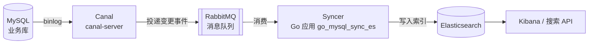
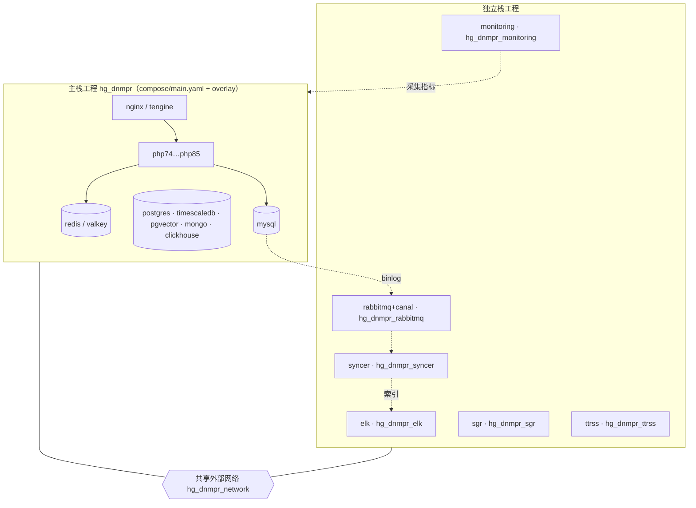

# HG_DNMPR


> **Docker / Podman 下一键编排的全栈开发与生产套件。**
> Nginx / Tengine + Apache-PHP 多版本 + 六种数据库 + Redis / Valkey + ELK + Prometheus 监控 + RabbitMQ / Canal / Syncer 数据同步链路 + Spug / Gitea / Rap2 研发工具链 + TTRSS 内容聚合，全部用一个入口脚本按服务、按栈拉起。

本仓库的本质是**用 Bash + Compose 把一套成熟的 LNP/LEMP 与数据基础设施打包成可复用的编排工程**：镜像在本地构建、版本用单开关切换、配置分层可回滚、敏感项永不入库。

> 想直接跑起来请看 [QUICK_START.md](QUICK_START.md)。本文侧重**当前仓库的真实业务功能、架构与配置约定**。

---

## 目录

- [核心业务功能](#核心业务功能)
- [支持的服务与默认端口](#支持的服务与默认端口)
- [架构总览](#架构总览)
- [环境要求](#环境要求)
- [快速开始](#快速开始)
- [配置体系](#配置体系)
- [版本开关](#版本开关)
- [关键运行约定](#关键运行约定)
- [监控与日志](#监控与日志)
- [数据与备份](#数据与备份)
- [故障排查](#故障排查)
- [文档索引](#文档索引)
- [贡献与许可证](#贡献与许可证)

---

## 核心业务功能

按业务域组织，每一域都是**可独立构建 / 启动的组合**（`./build.sh <域>` / `./up.sh <域>`）。

### 🌐 Web / PHP 开发环境

- **多版本 PHP 并存**：`php74` … `php85` 各自独立容器（镜像 `hg_dnmpr_phpXX_apache`），宿主机端口默认 `8074`–`8085`，方便同一台机器并行测试不同 PHP 版本。
- **双 Web 入口**：`nginx` / `tengine` 作为反向代理与静态与 PHP 入口，站点配置在 `vhost/`。
- **环境自适应**：`ENVIRONMENT` + `compose/overlays/{dev,prod}.yaml` 决定调试端口、资源限制；开发态为 Hyperf 等框架额外映射调试端口（默认 `9901`–`9903`），生产态不暴露。

### 🗄️ 数据与缓存

覆盖关系型、文档、时序、向量、列存与内存缓存六类，**互不干扰、各自独立数据目录**：

| 场景 | 服务 | 说明 |
| --- | --- | --- |
| 关系型 | `mysql` / `postgres` | 主业务库；MySQL 三档配置档（见下文） |
| 文档 | `mongo` | 附带 Mongo Express Web 管理界面 |
| 时序 | `timescaledb` | PostgreSQL + Timescale 扩展 |
| 向量 | `pgvector` | PostgreSQL + 向量检索扩展，适配 AI / 语义检索 |
| OLAP 列存 | `clickhouse` | 分析型列存，内置 Prometheus 指标端点 |
| 内存缓存 | `redis` / `valkey` | 口令由 Compose 注入 `--requirepass`，配置不明文保存 |

### 🔄 数据同步链路（CDC ➜ 消息 ➜ 索引）

本套件最成体系的业务能力：**把 MySQL 变更实时同步进 Elasticsearch，可用于构建搜索 / 报表**。



- `canal` / `canal-server`：捕获 MySQL binlog，产出变更事件（`compose/stacks/rabbitmq.yaml`，工程 `hg_dnmpr_rabbitmq`）。
- `syncer`：Go 同步服务，消费 RabbitMQ 消息并写入 Elasticsearch（`compose/stacks/syncer.yaml`，工程 `hg_dnmpr_syncer`）。
- `up.sh syncer` 会**自动检测并按需拉起** `rabbitmq` / `canal-server` / `elasticsearch` 等前置依赖。

### 📊 可观测性

- **ELK 日志栈**：Elasticsearch + Kibana + Logstash，独立工程 `hg_dnmpr_elk`。
- **指标监控栈**：Prometheus + Grafana + Alertmanager + Loki / Promtail + cadvisor / node-exporter / blackbox，以及按需为已运行服务挂载的 `*-exporter`（MySQL / Mongo / PG / Redis / Valkey / Nginx / Tengine / Timescale / pgvector / ClickHouse）。Grafana 预置同步、项目总览、MySQL、MongoDB 仪表盘。
- **智能装配**：`monitoring` 运行态只为**当前正在运行**的业务容器启用对应 exporter，避免无效监控目标。

### 🛠️ 研发工具链（`sgr` 组合，工程 `hg_dnmpr_sgr`）

| 工具 | 用途 |
| --- | --- |
| `spug` | 轻量运维 / 发布平台 |
| `gitea` | 自托管 Git 代码托管 |
| `rap2-dolores` / `rap2-delos` | API 接口文档与 Mock |

### 📰 内容聚合（`ttrss` 组合，工程 `hg_dnmpr_ttrss`）

Tiny Tiny RSS + `mercury` 正文解析 + `opencc` 简繁转换 + `rsshub` 生成器 + `watchtower` 镜像自动更新 + `browserless`。

---

## 支持的服务与默认端口

> 下表端口为**宿主机映射端口**（取自 `env/*.env`，可在 `.env` 覆盖）。容器内部端口可能不同（如 Elasticsearch 容器内 `9200`、宿主映射 `9333`）。

### 主栈（工程 `hg_dnmpr`）

| 服务 | 宿主端口（默认） | 版本开关 |
| --- | --- | --- |
| `nginx` / `tengine` | HTTP `80`、HTTPS `443` | — |
| `php74` … `php85` | `8074`–`8085` | `env/php.env` |
| `mysql` | `3306` | `MYSQL_BUILD_VERSION`（`8.0`/`8.4`/`9.7`） |
| `postgres` | `5432` | `PG_MAJOR` |
| `pgadmin` | `65050` | — |
| `timescaledb` | `5433` | `env/timescaledb.env` |
| `pgvector` | `5434` | `PGVECTOR_PG_MAJOR` |
| `mongo` | `60017` | `MONGO_BUILD_VERSION` |
| `mongo express` | `8081` | — |
| `clickhouse` | HTTP `8123` / TCP `9000` | `CLICKHOUSE_BUILD_VERSION` |
| `redis` | `63079` | `REDIS_BUILD_VERSION` |
| `valkey` | 见 `env/redis.env` | `VALKEY_BUILD_VERSION` |

### 独立栈

| 组合入口 | Compose 文件 | 工程名 | 组件（宿主端口） |
| --- | --- | --- | --- |
| `elk` | `compose/stacks/elk.yaml` | `hg_dnmpr_elk` | Elasticsearch `9333` · Kibana `56001` · Logstash `5044/9600/8050`（`ELK_BUILD_VERSION`） |
| `rabbitmq` / `canal` | `compose/stacks/rabbitmq.yaml` | `hg_dnmpr_rabbitmq` | RabbitMQ `56072`（管理台 `51672`）· Canal `11110/11111/11112` |
| `syncer` | `compose/stacks/syncer.yaml` | `hg_dnmpr_syncer` | Syncer `8080` |
| `monitoring` | `compose/stacks/monitoring.yaml` | `hg_dnmpr_monitoring` | Prometheus `9090` · Grafana `3000` · exporters 等 |
| `sgr` | `compose/stacks/sgr.yaml` | `hg_dnmpr_sgr` | Spug `8000` · Gitea `3000`(+SSH `2220`) · Rap2 `28081` |
| `ttrss` | `compose/stacks/ttrss.yaml` | `hg_dnmpr_ttrss` | TTRSS `8181` · RSSHub `61200` |
| `all` | 主栈聚合 | `hg_dnmpr` | 主栈可构建服务集合 |

**镜像命名约定**

- 主栈：`hg_dnmpr_<服务>:latest`（如 `hg_dnmpr_nginx`、`hg_dnmpr_php84_apache`、`hg_dnmpr_mysql`）
- ELK 栈：`hg_dnmpr_elk_<服务>:latest`；RabbitMQ 栈：`hg_dnmpr_rabbitmq_<服务>:latest`
- 备份类：`hg_dnmpr_mysql_backup`、`hg_dnmpr_mongo_backup`、`hg_dnmpr_postgres_backup`、`hg_dnmpr_pgvector_backup`、`hg_dnmpr_clickhouse_backup`（TimescaleDB 备份复用官方镜像）

---

## 架构总览

```
hg_dnmpr/
├── build.sh / up.sh          # 构建与编排入口（唯一生命周期入口）
├── docker_manager.sh         # Docker 运行时安装 / 修复（独立脚本）
├── podman_manager.sh         # Podman 同理
├── .env / .env.example       # 本地敏感与开关（.env 不入库）
├── env/                      # 分层非敏感默认（按服务拆分）
├── compose/
│   ├── main.yaml             # 主栈装配（工程名 hg_dnmpr）
│   ├── stacks/               # web / php / databases / elk / rabbitmq / syncer / monitoring / sgr / ttrss
│   └── overlays/             # dev / prod / wsl / docker-opts / elk-nginx
├── build/<组件>/<版本>/       # 各服务 Dockerfile 与配置上下文
├── include/shell/            # 公共库（env_loader、proxy、compose_orchestrator、service_catalog、version_resolve…）
├── vhost/                    # Nginx / Tengine / Apache 站点配置
├── scripts/                  # 校验、备份、巡检脚本
└── docs/                     # 专题文档
```

### 服务拓扑与装配关系



### Compose 与网络

- 统一外部网络：`hg_dnmpr_network`（Docker 模式下由 `up.sh` 预建，名称不是 `hg_dnmpr_default`）。
- 主栈由 `compose/main.yaml` 聚合 `stacks/*` 与当前环境 overlay；独立栈只加载自身 `stacks/*.yaml`，不与 `main.yaml` 混用。
- 服务名映射、组合展开与 `-f` 文件选择集中在 `include/shell/service_catalog.sh`（单一数据源）。

### 数据落盘

多数数据库默认路径为 `${DATA_PATH_HOST}/${*_DATA_SUBDIR}`（可在 `.env` 覆盖为完整 `*_DATA_PATH`）。Redis / Valkey 默认可用 named volume（`redis_data` / `valkey_data`）；ELK 数据/日志常为宿主机 bind（Elasticsearch data 目录需对容器 UID `1000` 可写）。**不要假设「全部是 named volume」**。

---

## 环境要求

| 项 | 要求 / 说明 |
| --- | --- |
| 宿主 OS | Linux 或 Windows + WSL2（仓库位于 `E:\hg_dnmpr`，WSL 挂载为 `/mnt/e/hg_dnmpr`） |
| 容器运行时 | Docker（含 Compose V2）**或** Podman；缺失时用 `docker_manager.sh` / `podman_manager.sh` 安装修复 |
| Shell | Bash（脚本主体语言，**不可用 `sh` 直接执行**） |
| 换行 | 强制 LF（`.gitattributes` 已约束 `*.sh` / `*.env` / `*.cnf` / `*.yaml` 等） |
| WSL 网络 | WSL2 默认 NAT，**不镜像** localhost 代理；需代理时显式配置 `PROXY_*` 并置 `BUILD_PROXY_ENABLED=true` |
| 行号约定 | 命令与校验默认在 WSL 内执行；PowerShell 仅用于宿主侧操作（git、文件复制、Windows 服务） |

---

## 快速开始

```bash
# 0) 进入 WSL 仓库目录
cd /mnt/e/hg_dnmpr

# 1) 准备敏感配置（口令、ENVIRONMENT、代理开关）
cp .env.example .env    # 然后编辑 .env

# 2) 构建（示例：常用开发组合）
./build.sh nginx php84 mysql redis
./build.sh elk          # 独立栈按需构建

# 3) 启动
./up.sh nginx php84 mysql redis
./up.sh elk
./up.sh monitoring

# 4) 常用操作
./up.sh php84 stop | restart | logs | ps
./up.sh --help          # 全部子命令与参数
```

一键构建并启动全部主栈服务：

```bash
./build.sh all --auto-prune --auto-up
```

`build.sh` / `up.sh` 支持 `--no-cache`、`--parallel`、`--multi-arch`、`--push`、`--auto-up`、`--auto-prune`、`--dry-run` 等（**以脚本 `--help` 为准**，改 CLI 会同步 `include/shell/up_helpers.sh` / `common_functions.sh` 的帮助文本）。

> 数据同步链路（Canal ➜ RabbitMQ ➜ Syncer ➜ ES）的启动与验证步骤见 [QUICK_START.md](QUICK_START.md) 与 `compose/stacks/syncer.yaml` 顶部注释。

**独立工具**（凭据走 `*.local.env`，已 gitignore）

- `gost-client-forwarder.sh` / `gost-server-manager.sh`：本地代理转发
- `mkcert_im.sh` / `acme_renew_domain_cert.sh`：本地与域名证书签发、自动续期（CA 自动评估：已有证书沿用 → Let's Encrypt → ZeroSSL → Actalis / SSL.com / Google；可用 `ACME_CA=<短名>` 强制指定）

---

## 配置体系

优先级（高 ➜ 低）：

1. **进程环境变量**（含临时 `export`）
2. 根目录 `.env` / `.env.local`（敏感口令、`ENVIRONMENT`、代理开关等，**不入库**）
3. `env/*.env`（**非敏感**默认值与版本开关，禁止写代理账密）
4. Compose / Dockerfile 内嵌默认值

运行时 `up.sh` 会合并生成 `.env.runtime`（含明文密钥，已 gitignore），供 Compose `--env-file` 使用；**禁止手改、禁止入库**。进容器的 env 末尾加载 `env/container-strip-host-proxy.env`，清空宿主构建代理，避免业务容器误走本机代理（改此文件会影响所有容器，须评估影响面）。

### 构建代理

| 项 | 说明 |
| --- | --- |
| 开关 | `.env` 中 `BUILD_PROXY_ENABLED=true\|false` |
| 类型偏好 | `BUILD_PROXY_TYPE`（如 `socks5h`）；空则回落 `PROXY_SCHEME` |
| 凭据真源 | 系统环境：`PROXY_SCHEME` `PROXY_HOST` `PROXY_PORT` `[PROXY_USER]` `[PROXY_PASS]` |
| URL | **禁止**写入 `.env`；仅当开关开启时由 `include/shell/proxy.sh`（及 `docker_manager` / `podman_manager` / `acme_renew_domain_cert.sh`）拼装 |
| 临时覆盖 | 当前 shell：`export BUILD_PROXY_URL='...'` |

### 密码与密钥

口令统一放在根目录 `.env`（参考 `.env.example` 占位符）。Redis / Valkey 通过 Compose 注入 `--requirepass`，配置文件不保存明文。回复、日志、提交信息中展示配置一律脱敏（`***`）。

---

## 版本开关

在对应 `env/*.env`（或 `.env` 覆盖）修改系列号后重新 `build` / `up` 即可；**改版本号必须同步创建 `build/<组件>/<新版本>/`**。

| 变量 | 文件 | 含义 |
| --- | --- | --- |
| `MYSQL_BUILD_VERSION` | `env/mysql.env` | MySQL 大系列（`8.0`/`8.4`/`9.7`） |
| `REDIS_BUILD_VERSION` | `env/redis.env` | Redis 大系列 |
| `VALKEY_BUILD_VERSION` | `env/redis.env` | Valkey 大系列 |
| `ELK_BUILD_VERSION` | `env/elk.env` | ELK 大系列（路径 `build/elk/<系列>/`） |
| `MONGO_BUILD_VERSION` | `env/mongodb.env` | Mongo 系列 |
| `CLICKHOUSE_BUILD_VERSION` | `env/clickhouse.env` | ClickHouse 系列 |
| `PG_MAJOR` / `PGVECTOR_PG_MAJOR` | `postgres.env` / `pgvector.env` | PG 主版本 |

解析与下载逻辑集中在 `include/shell/version_resolve.sh`、`download_dependencies.sh`。

---

## 关键运行约定

### MySQL 配置档（三档互斥）

| 宿主机 | `ENVIRONMENT` | 实际加载 |
| --- | --- | --- |
| WSL | **任意**（覆盖判定） | `mysql-wsl.cnf`（忽略 `ENVIRONMENT`） |
| 非 WSL | `dev` / `development` / 未设 | `mysql-dev.cnf` |
| 非 WSL | `prod` / `production` | `mysql-prod.cnf` |

WSL 档为减轻 WSL2 I/O 延迟放宽了部分安全项，**勿用于生产数据**。版本漂移与运行时校验：

```bash
bash scripts/check-mysql-cnf-drift.sh              # 静态：无需镜像
bash scripts/check-mysql-cnf-drift.sh --validate   # 追加镜像级校验（需已构建镜像）
bash scripts/check-mysql-runtime-cnf.sh            # 运行态只读自检（需容器已启动）
```

细则见 [docs/AGENTS-MYSQL.md](docs/AGENTS-MYSQL.md)（改动 cnf 前必读）。

### PHP 环境分流

`env/php.env` 的运行时与资源限制使用 `PHP_DEV_*` / `PHP_PROD_*`，由 `ENVIRONMENT` 选择 overlay 注入。开发环境可为 Hyperf 等额外端口做映射（`compose/overlays/dev.yaml`）；生产 overlay 不暴露这些开发端口。

### 虚拟主机

站点配置位于 `vhost/nginx_vhost/`、`vhost/apache_vhost/`（及 Tengine 对应目录）；修改后重载 / 重建对应 Web 容器即可生效。

---

## 监控与日志

```bash
./up.sh monitoring          # Prometheus + Grafana 等
./build.sh elk && ./up.sh elk
```

- 开发态（`ENVIRONMENT=development`）监控端口绑定 `127.0.0.1`，仅本机访问；生产态绑定 `0.0.0.0`，需自行放行防火墙/安全组。可 `export MONITORING_PUBLISH_HOST=0.0.0.0` 临时覆盖。
- 默认地址：Prometheus `http://localhost:9090` · Grafana `http://localhost:3000` · Kibana 宿主端口 `56001`。
- Logstash 管道在 `build/elk/${ELK_BUILD_VERSION}/logstash/`；容器日志轮转由 `LOG_MAX_SIZE` / `LOG_MAX_FILE`（`env/base.env`）控制。
- ELK 首次启动若 data 目录为 root 创建的 bind 路径，需保证 Elasticsearch 进程用户（UID `1000`）可写；`up` 流程会对绝对路径数据目录做属主对齐。

专题见 [docs/monitoring.md](docs/monitoring.md)。

---

## 数据与备份

- **应用级**：`include/shell/backup-*.sh`、`scripts/mysql-backup.sh`、`scripts/docker_mysql_backup_restore.sh`
- **Volume 级**：`scripts/docker-backup-restore.sh`、`scripts/backup-all-volumes.sh`（适用于使用 named volume 的路径）
- **bind mount 数据目录**：按宿主机路径做文件系统备份，勿只依赖 `docker volume` 工具

定期验证恢复流程；生产请配合异地副本。破坏性清理（`clean-all` / `purge` / `delete` / `prune --all-global`、删除卷）执行前先跑 `--dry-run`，并保护 `PROTECTED_VOLUMES`（默认含 `hg_dnmpr_elk_elasticsearch_data`）。

---

## 故障排查

| 现象 | 方向 |
| --- | --- |
| 端口占用 | 改 `env/*.env` 对应端口变量后 `./up.sh <svc> restart` |
| 构建拉包失败 | 检查 `BUILD_PROXY_ENABLED` 与系统 `PROXY_*`；或设 `CHANGE_SOURCE=true` |
| 网络找不到 | `docker network inspect hg_dnmpr_network`；由 `up.sh` 预建，名称不是 `hg_dnmpr_default` |
| MySQL 像「生产档」却在 WSL | 预期：WSL 固定 `mysql-wsl.cnf`；生产请在非 WSL 主机部署 |
| Elasticsearch unhealthy / `node.lock` | 检查 data bind 目录属主是否为 `1000:0` |
| 代理进了业务容器 | 确认 `container-strip-host-proxy.env` 在 env_file 末尾 |
| Syncer 起不来 | 确认 `rabbitmq` / `canal-server` / `elasticsearch` 已就绪（`up.sh syncer` 会自动检测依赖） |

```bash
./up.sh <服务> logs
docker compose --env-file .env.runtime -f compose/main.yaml config
```

> 本仓库**没有 CI**；`shellcheck` 默认未安装。验证以 `bash -n`、`./up.sh <svc> --dry-run`、`scripts/check-*.sh` 为准。

---

## 文档索引

| 文档 | 内容 |
| --- | --- |
| [QUICK_START.md](QUICK_START.md) | 快速启动、常用命令、WSL 优化、备份 |
| [AGENTS.md](AGENTS.md) | Agent / 协作核心规则（动手前必读） |
| [docs/AGENTS-MYSQL.md](docs/AGENTS-MYSQL.md) | MySQL 版本与 cnf 核验 |
| [docs/monitoring.md](docs/monitoring.md) | 监控栈专题 |
| [.env.example](.env.example) | 本地敏感配置模板 |

---

## 贡献与许可证

- Issue / PR：说明环境（Docker 或 Podman、是否 WSL）、复现步骤与相关日志（**注意脱敏**）。
- Shell 变更请保持可验证：`bash -n`、相关 `scripts/check-*.sh`；改 CLI 同步 `--help` 与文档。
- 新增服务遵循「两处都改」：`compose/stacks/<栈>.yaml` 定义 + `compose/main.yaml` `extends` 引用；列表型字段勿在 `stacks/` 与 `main.yaml` 重复声明。
- 许可证：[MIT License](LICENSE)

如遇到问题，优先查阅 [QUICK_START.md](QUICK_START.md) 与上表专题文档。
